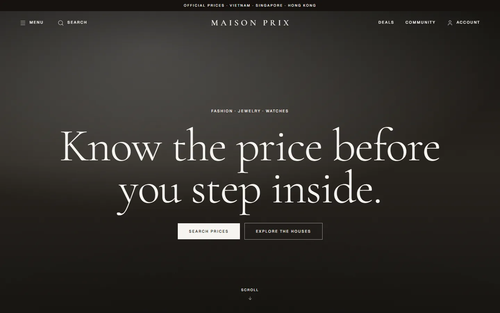
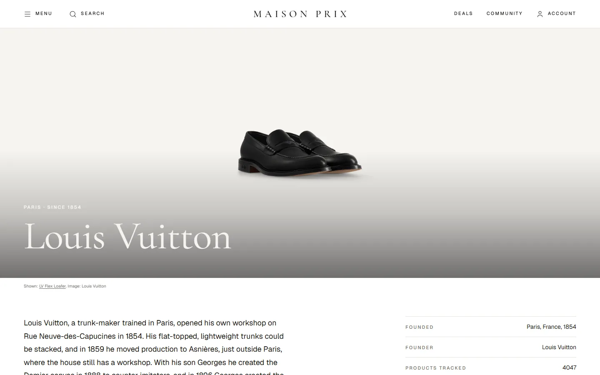
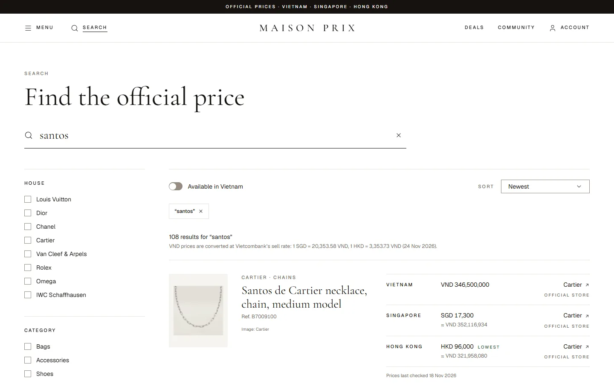
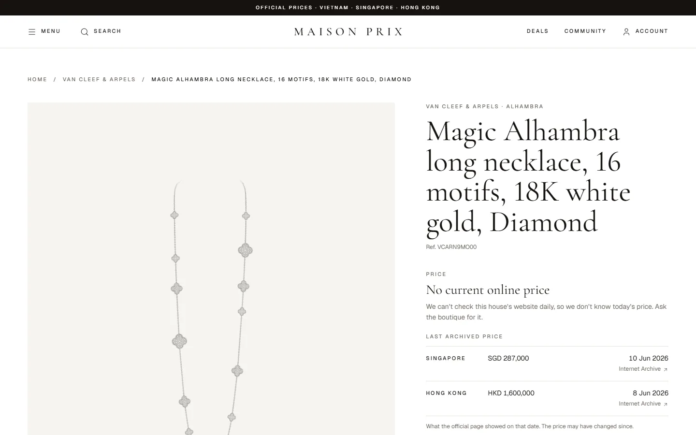
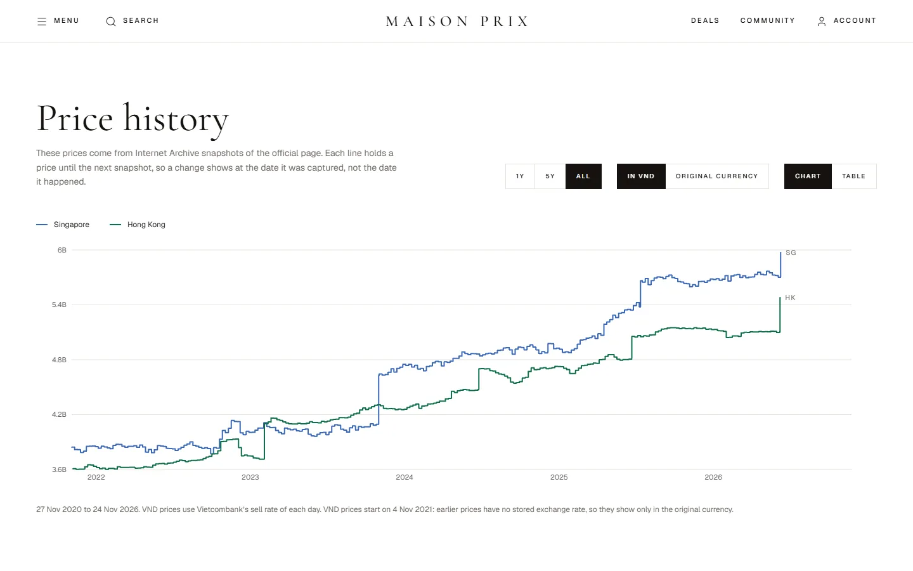
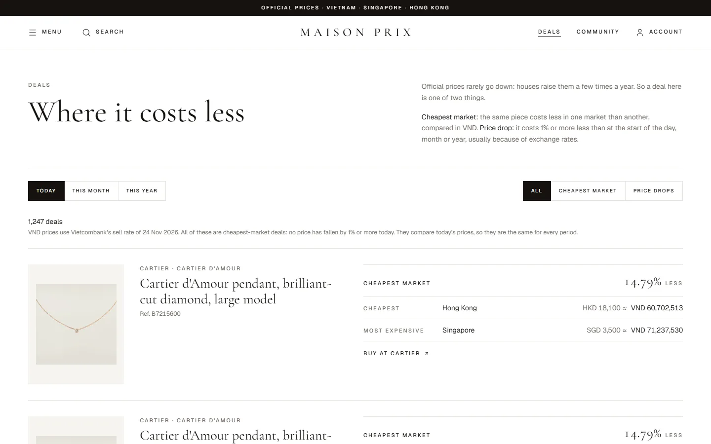
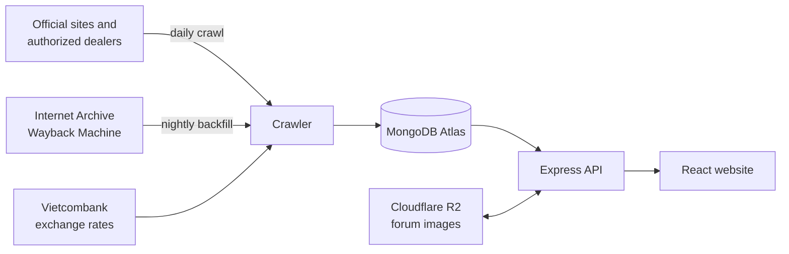

# Maison Prix

**Know the price before you step inside.**

Maison Prix is a quiet, editorial price guide to the great houses: Louis Vuitton, Dior, Chanel, Cartier, Van Cleef & Arpels, Rolex, Omega and IWC. It gathers their **official** prices in Vietnam, Singapore and Hong Kong, sets them side by side in VND, and keeps every change, so a buyer walks into the boutique already knowing the number.

*A non-commercial university project, not affiliated with any brand.*



## The idea

In Vietnam, many luxury houses don't publish their prices. To learn what a bag or a watch costs, you walk into a boutique, or you trust resellers and social media posts that may be months out of date.

Maison Prix takes prices only from **official brand websites and authorized dealers**: never resellers, marketplaces or the grey market. Every price carries its source and the date it was seen, and links back to where it came from. Prices from abroad are converted to VND at Vietcombank's sell rate **for that day**, so a 2021 Singapore price is read at the 2021 rate, not today's.

## A walk through the maison

### The houses

The home page reads like a house's own lookbook: full-bleed imagery, generous white space, a serif display face (Cormorant Garamond) and a restrained black, white and stone palette. Each house gets its own chapter, with its history, key facts and signature pieces.



### Search, with every market at a glance

Search by name, collection or reference, then filter by house, category, collection, market, VND price range, or "available in Vietnam". Each result shows the price in every market, the cheapest one marked, and a direct link to the official store or authorized dealer.



### The piece

Every product has a gallery of 2 to 4 images, a description and specifications, and the current price per market with where to buy it. For houses whose sites can't be read daily, the page says so plainly and shows the last price an archived copy of the official page recorded.



### Price history

The signature feature, in the spirit of Chrono24: a line per market, in VND or the original currency, over 1 year, 5 years or all time, with a table view for the exact numbers. The chart below follows a Magic Alhambra necklace from 2020 to today in Singapore and Hong Kong.



### Deals

Official luxury prices almost never go down, so a deal here isn't a sale. It's one of two things, ranked by percentage saved, with Today, This month and This year tabs:

- **Cheapest market:** the same piece costs less in one market than another, after converting to VND.
- **Price drop:** the price is at least 1% lower than at the start of the period, in its own currency or in VND because of exchange rates.



### Community

A members-only forum for people who care about this world: start a topic, reply, share photos. It includes basic moderation tools.

## The collection in numbers

As of 24 November 2026:

| | |
|---|---|
| Houses | 8 |
| Markets | 3 (Vietnam, Singapore, Hong Kong) |
| Pieces tracked | 12,212 |
| Price history points | 21,834, the earliest from January 2019 |
| Daily exchange rates | 1,850 days, from Vietcombank |

| House | Where the prices come from | Markets |
|---|---|---|
| Cartier | Official website, crawled daily | VN, SG, HK |
| Rolex | Authorized dealers DAFC, The Hour Glass and Oriental Watch, crawled daily | VN, SG, HK |
| Omega | Official website, crawled daily | HK |
| Louis Vuitton, Dior, Van Cleef & Arpels, IWC | Internet Archive copies of the official websites: price history, no daily price | SG, HK |
| Chanel | Internet Archive copies of the official websites, from 2023 | SG, HK, VN |

Several official sites refuse automated visitors. Maison Prix respects that and never works around bot protection. Their prices come from what the Internet Archive saved of the same official pages, and the site says so on every one of those products.

## Behind the atelier



The repository has four areas:

| Folder | Role | Stack |
|---|---|---|
| `frontend/` | The website | React 19, Vite, Tailwind CSS 4, shadcn/ui, Recharts, React Router |
| `backend/` | REST API, accounts, forum, image uploads | Node.js, Express 5, Mongoose, sharp, S3 SDK |
| `crawler/` | Prices, product details, archive history, exchange rates | Node.js, cheerio, Mongoose, robots-parser |
| `devops/` | Environments, CI, schedules, deployment | GitHub Actions, MongoDB Atlas, Vercel, Render |

### The crawler

- **Polite by design.** Every request goes through one function, which reads `robots.txt`, honours `Crawl-delay`, waits between requests to the same host and identifies itself honestly. A site that answers with bot protection is marked `blocked` and left alone.
- **One adapter per source.** Each source returns the same normalized product, so adding a source never touches the others.
- **One product across markets.** The same piece is matched across markets by the house's reference code, never by name.
- **Safe to re-run.** Products and offers are upserted, and a history point is added only when a price actually changes.
- **Internet Archive backfill.** It queues one archived copy per product page per quarter, then reads a sample (one per year plus the newest), so the history reaches back years without hammering the archive.

### The API

- **Catalog:** `/api/brands`, `/api/products` (text search, filters, paging), `/api/products/:brand/:ref` and `/history`, and `/api/deals`. Everything is documented in [`docs/API.md`](docs/API.md).
- **Deals:** computed from the whole catalog and cached for 5 minutes per period.
- **Accounts:** passwords hashed with scrypt, sessions in httpOnly cookies, rate limits on login and sign-up, and an Origin check on every write.
- **Forum images:** resized with sharp, then stored in S3-compatible storage (Cloudflare R2 in production, local disk in development).
- **Bandwidth:** responses are gzip-compressed to stay within the free hosting plan's bandwidth.

### Running in production

| Part | Where |
|---|---|
| Website | Vercel, which also forwards `/api` to the backend so the login cookie stays first-party |
| API | Render, Singapore region |
| Database | MongoDB Atlas, Singapore region |
| Forum images | Cloudflare R2 |
| Daily crawl and nightly history backfill | GitHub Actions, with an issue opened automatically when a scheduled run fails |
| CI | GitHub Actions on every push: lint all three apps, build the website, run the API's tests and a smoke test |

The step-by-step setup is in [`devops/DEPLOY.md`](devops/DEPLOY.md).

## Getting started

You need [Node.js](https://nodejs.org/) 20.19 or newer and a [MongoDB Atlas](https://www.mongodb.com/atlas) connection string. [`devops/ENVIRONMENT.md`](devops/ENVIRONMENT.md) explains every setting.

```bash
git clone https://github.com/HvH1110/Web_Project.git
cd Web_Project
```

**1. Backend** (http://localhost:5000)

```bash
cd backend
npm install
cp .env.example .env      # then put your connection string in MONGODB_URI
npm run seed:brands       # loads the house histories
npm run dev
```

**2. Frontend** (http://localhost:5173), in a second terminal

```bash
cd frontend
npm install
cp .env.example .env
npm run dev
```

**3. Crawler** (optional, to collect product data), in a third terminal

```bash
cd crawler
npm install
cp .env.example .env      # then put your connection string in MONGODB_URI
npm run crawl -- cartier-sg --limit=5
```

Leave out the source name and limit to crawl every source, which takes a few hours.

## How it was built

Maison Prix was built with four [Claude Code](https://claude.com/claude-code) sessions working in parallel, one per area. Each session owns its own folder and talks to the others only through written contracts: [`docs/API.md`](docs/API.md) between the website and the API, and [`docs/DATA.md`](docs/DATA.md) between the crawler and the API. [`docs/WORKFLOW.md`](docs/WORKFLOW.md) describes the setup.

## Documentation

- [Product spec](docs/PRODUCT.md): what the site does and the rules behind it
- [API reference](docs/API.md): every endpoint
- [Data model](docs/DATA.md): how products, prices and rates are stored
- [Sources](crawler/SOURCES.md): every site checked, and what was found
- [Environment](devops/ENVIRONMENT.md) and [deployment](devops/DEPLOY.md) guides

## Disclaimer

Maison Prix is not affiliated with or endorsed by any brand mentioned. Prices are indicative, so always confirm with the official store. Brand names are trademarks of their owners, and product images belong to their owners and are credited to their source on every page.

## Author

Huynh Vu Hoang
