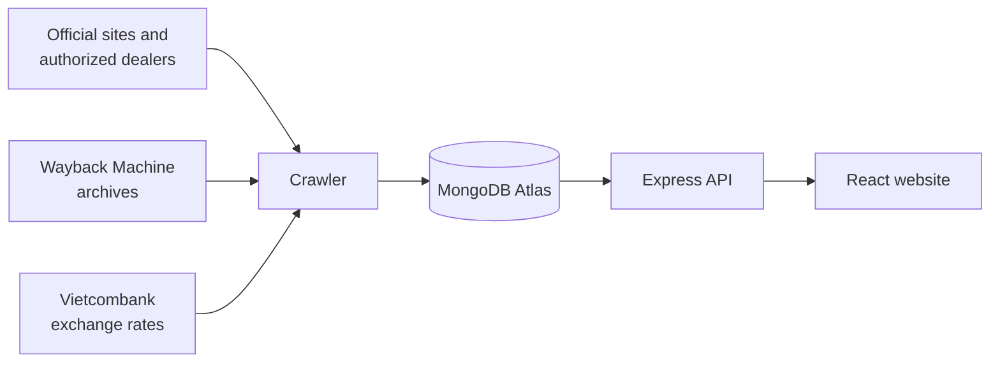

# Maison Prix

**Know the price before you step inside.**

Maison Prix is a website for looking up the official prices of luxury goods, comparing them across Vietnam, Singapore and Hong Kong, and seeing how they have changed over time.

*A non-commercial university project, not affiliated with any brand.*

## Why this project exists

In Vietnam, many luxury houses don't publish their prices. To find out what a bag or a watch costs, a buyer has to walk into a boutique or rely on resellers and social media posts, which may not be accurate.

Maison Prix collects prices only from **official brand websites and authorized dealers**, never from resellers or marketplaces, and every price links back to where it came from. Prices from other markets are converted to VND, so a buyer can see at a glance what an item costs at home and abroad.

## Features

- **Luxury-house home page:** an editorial design with each brand's history, key facts and signature products.
- **Search:** find products by text and filter by brand, category, collection, market and price, with Vietnamese letters handled correctly. Each result shows the price per market and where to buy.
- **Product pages:** image gallery, description, specifications, current prices, and a **price history line chart**, in the style of Chrono24.
- **Deals:** Today, This month and This year tabs, showing the cheapest market for an item and price drops of 1% or more.
- **Community forum:** members can create topics and reply with text and images, with moderation tools.
- **Accounts:** register, log in and manage a profile.

### What counts as a deal?

Official luxury prices rarely go down, so a deal here isn't a discount. It's one of two things:

- **Cheapest market:** the biggest gap between the cheapest and most expensive market for the same item, after converting to VND.
- **Price drop:** the price is at least 1% lower than at the start of the period, in its own currency or in VND because the exchange rate moved.

## Data coverage

| Brand | Where the prices come from | Markets |
|---|---|---|
| Cartier | Official website | VN, SG, HK |
| Rolex | Authorized dealers (DAFC, The Hour Glass) | VN, SG |
| Omega | Official website | HK |
| Louis Vuitton, Dior, IWC | Archived copies of the official websites (Wayback Machine): past prices only | SG, HK |
| Chanel, Van Cleef & Arpels | Brand information only: their websites block automated access | None |

Several official websites block crawlers. Maison Prix respects that and doesn't try to get around it. The crawler also follows `robots.txt`, identifies itself honestly, and waits between requests.

**Price history** comes from regular crawls and, for sites that block crawlers, from Wayback Machine archives. It is only stored when a price changes. Foreign prices are converted using Vietcombank's sell rate for the relevant date.

## How it works



The project is split into four areas:

| Folder | Purpose | Main tools |
|---|---|---|
| `frontend/` | The website | React 19, Vite, Tailwind CSS 4, shadcn/ui, Recharts, React Router |
| `backend/` | REST API, accounts, forum and image uploads | Node.js, Express 5, Mongoose, sharp |
| `crawler/` | Collects prices, product details and exchange rates | Node.js, cheerio, Mongoose |
| `devops/` | Environment and deployment guides | GitHub Actions, MongoDB Atlas |

## Getting started

You need [Node.js](https://nodejs.org/) 20.19 or newer and a [MongoDB Atlas](https://www.mongodb.com/atlas) connection string. `devops/ENVIRONMENT.md` explains how to set up Atlas and what each setting does.

```bash
git clone https://github.com/HvH1110/Web_Project.git
cd Web_Project
```

**1. Backend** (http://localhost:5000)

```bash
cd backend
npm install
cp .env.example .env      # then put your connection string in MONGODB_URI
npm run seed:brands       # loads the brand information
npm run dev
```

**2. Frontend** (http://localhost:5173), in a second terminal

```bash
cd frontend
npm install
cp .env.example .env
npm run dev
```

**3. Crawler** (optional, to collect product data), in a third terminal

```bash
cd crawler
npm install
cp .env.example .env      # then put your connection string in MONGODB_URI
npm run crawl -- cartier-sg --limit=5
```

Leave out the source name and limit to crawl every source, which takes a few hours.

## Project status

The website, API and crawler are built, and CI runs on every push. Still to do:

- Deploy the site (planned: Vercel for the website, Render for the API, Cloudflare R2 for forum images).
- Turn on the daily crawl schedule.
- Extend the price history through the Wayback Machine archives.
- Review the draft brand histories.

## Documentation

- [Product spec](docs/PRODUCT.md): what the site does and the rules behind it
- [API reference](docs/API.md): every endpoint
- [Data model](docs/DATA.md): how products, prices and rates are stored
- [Sources](crawler/SOURCES.md): every site checked, and what was found
- [Environment](devops/ENVIRONMENT.md) and [deployment](devops/DEPLOY.md) guides
- [Development workflow](docs/WORKFLOW.md): how this project is built with four parallel Claude Code sessions

## Disclaimer

Maison Prix is not affiliated with or endorsed by any brand mentioned. Prices are indicative, so always confirm with the official store. Brand names are trademarks of their owners, and product images belong to their owners and are credited to their source.

## Author

Huynh Vu Hoang
